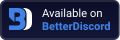

<p align="center">Hi, Ridge here. I'm continuing this project on <a href="https://codeberg.org/ridge/Discord-AdBlock" target="_blank">Codeberg</a> as it seems CroissantDuNords account here is inactive. I've been updating the project on and off with irregular intervals, but due to my distaste for using GitHub, anyone who wishes to contribute or submit issues are encouraged to use Codeberg from now on, or fork this project to keep adding to it here. Thank you.</p>
<h1><a href="https://codeberg.org/ridge/Discord-AdBlock"></a></h1>

<p align="center">
  
</p>
<h1 align="center">Discord AdBlock</h1>
<h3 align="center">The ads for Discord Nitro bother you, you can now delete them</h3>
</p>

---

Main adblock list for Nitro ads:
```css
@import url(https://croissantdunord.github.io/discord-adblock/adblock.css);
```

Extra adblock list to remove profile customisations and Nitro-related badges:  
(Alternatively, consider opening adblock-extras.css to only pick the elements that you want to remove.)
```css
@import url(https://croissantdunord.github.io/discord-adblock/adblock-extras.css);
```

[](https://raw.githubusercontent.com/CroissantDuNord/discord-adblock/main/adblock.css)
[](https://raw.githubusercontent.com/CroissantDuNord/discord-adblock/main/adblock.css)

---
## 🛡️ Main list
The main rule list that remove nitro ads and features that require nitro.  
- [x] Ads in profile tabs.
- [x] Ads in the settings menus.
- [x] Upsells in free features (screen sharing, etc.)
- [x] Full screen ads.
- [x] Banner ads.
- [x] Store and nitro buttons.
- [x] Gift button.
- [x] Server boost elements.
- [x] Super reaction elements.
- [x] Message limit warning.
- [x] App launcher icons.
- [x] Seasonal nitro nags.
---
## 🛡️ Extras list
A very opinionated list with CSS rules that can remove various annoyances and superfluous gimmicks.
It's recommended you look inside adblock-extras.css to pick only the elements you want to block specifically.  
- [x] All Nitro profile customisations (Avatar frames, effects, etc.)
- [x] Profile badges.
- [x] Server boost elements.
- [x] Activity list in guild members list.
- [x] Forward button in message hoverbar.
- [x] Discover button.
- [x] Soundmoji.
---

## ❓ Installation Guide

1. You need a client mod (Like [BetterDiscord](https://betterdiscord.app/) or [Vencord (Recommended)](https://vencord.dev))

- **BetterDiscord:**
Open the CustomCSS Tab in the user settings
- **Vencord:**
Open settings, choose "Vencord", then "Edit QuickCSS"

2. Copy & Paste this CSS into the Custom CSS input *(This will load adblock.css from here, this mean that it will auto-update from this repo)*

For main adblock:
```css
@import url("https://croissantdunord.github.io/discord-adblock/adblock.css");
```
- (Optional) For **ALL** the extras, add this as well on a new line:
```css
@import url("https://croissantdunord.github.io/discord-adblock/adblock-extras.css");
```


3. Done. Enjoy a slightly less frustrating Discord experience. 👍

## Issues or suggestions

You can report any problems and suggest ideas by [opening an issue](https://github.com/CroissantDuNord/discord-adblock/issues).

